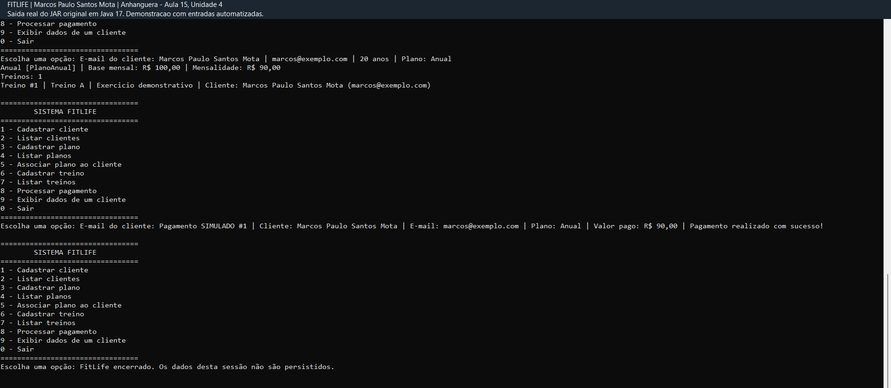

# FitLife — Implementação e Validação

**Autor: Marcos Paulo Santos Mota**  
**Instituição:** Anhanguera  
**Curso:** Sistemas de Informação  
**Atividade:** Aula 15 — Unidade 4 — Programação Orientada a Objetos

Sistema de console em Java para gerenciar clientes, planos de academia, treinos e pagamentos simulados. O objetivo é integrar e testar os conceitos de POO estudados na disciplina.

## Arquitetura e requisitos

Os modelos guardam dados e invariantes; os serviços coordenam cadastros em `ArrayList`; o console apresenta o menu e trata erros de entrada. `Main` inicia o programa. Não há banco de dados ou framework de aplicação.

| Requisito | Implementação |
|---|---|
| Cadastrar nome, e-mail e idade | `Cliente`, `ClienteService` |
| Impedir nome vazio, e-mail inválido e idade abaixo de 15 | `Validacao`, construtor e setters de `Cliente` |
| Cadastrar e listar planos | `PlanoService`, `PlanoMensal`, `PlanoAnual`, `PlanoPremium` |
| Associar plano cadastrado a cliente existente | `ClienteService.associarPlano` |
| Cadastrar e consultar treinos por cliente e ID | `Treino`, `TreinoService` |
| Calcular e processar mensalidades | `Pagavel`, `PagamentoService`, `Pagamento` |
| Impedir pagamento sem plano | `PagamentoService.processarPagamento` |
| Impedir busca/associação a cadastro inexistente | `EntidadeNaoEncontradaException`, serviços |
| Exibir informações e repetir o menu até sair | `ConsoleApp`, `Main` |
| Testar funcionalidades e entradas inválidas | Quatro classes JUnit 5 em `src/test/java` |
| Explicar, apresentar e entregar | Este README, `docs/GUIA_DIDATICO.md`, evidências em `docs` |

A imagem do enunciado cita Mensal e Premium. O pedido detalhado também exige Anual. Os três foram implementados.

## Tecnologias

- Java 17 ou superior, compilado com `--release 17`.
- Maven 3.9 ou superior para compilar, executar os testes e gerar o JAR.
- JUnit Jupiter **5.11.4**, exclusivamente nos testes.
- Biblioteca padrão Java: `ArrayList`, `Scanner`, `BigDecimal`, entre outras.
- Git e GitHub para versionamento; workflow de validação em Java 17.

O sistema não depende do Maven nem do JUnit em tempo de execução. É possível compilar apenas com o JDK. As versões dos componentes de compilação estão fixadas no `pom.xml`.

Referências oficiais: [JDK Temurin](https://adoptium.net/temurin/releases/?version=17), [Maven](https://maven.apache.org/download.cgi), [JUnit 5.11.4](https://docs.junit.org/5.11.4/user-guide/).

## Estrutura

```text
FitLife/
├── pom.xml
├── README.md
├── ENTREGA.md
├── Executar_FitLife.cmd
├── compilar-executar.cmd
├── compilar-executar.sh
├── .gitignore
├── .gitattributes
├── .github/workflows/java.yml
├── src/
│   ├── main/java/fitlife/
│   │   ├── Main.java
│   │   ├── console/ConsoleApp.java
│   │   ├── exception/
│   │   │   ├── DadosInvalidosException.java
│   │   │   └── EntidadeNaoEncontradaException.java
│   │   ├── interfaces/Pagavel.java
│   │   ├── model/
│   │   │   ├── Cliente.java
│   │   │   ├── Plano.java
│   │   │   ├── PlanoMensal.java
│   │   │   ├── PlanoAnual.java
│   │   │   ├── PlanoPremium.java
│   │   │   ├── Treino.java
│   │   │   └── Pagamento.java
│   │   ├── service/
│   │   │   ├── ClienteService.java
│   │   │   ├── PlanoService.java
│   │   │   ├── TreinoService.java
│   │   │   └── PagamentoService.java
│   │   └── util/
│   │       ├── Validacao.java
│   │       └── Formatacao.java
│   └── test/java/fitlife/
│       ├── ClienteTest.java
│       ├── PlanosTest.java
│       ├── ServicosTest.java
│       └── ConsoleAppTest.java
└── docs/
    ├── GUIA_DIDATICO.md
    ├── CODIGO_COMPLETO.md
    ├── VALIDACAO.md
    ├── exemplo-entrada.txt
    ├── execucao-real.txt
    ├── print-entrada.txt
    ├── print-saida.txt
    └── imagens/fitlife-execucao.png
```

Foi adotada a estrutura padrão Maven, `src/main/java` e `src/test/java`, para separar aplicação e testes e facilitar a importação nas IDEs. `docs/CODIGO_COMPLETO.md` reúne todos os arquivos de código, sempre identificando o caminho antes do conteúdo.

## Regras do sistema

- A idade mínima é **15 anos**, inclusive.
- Nome e descrição não podem ser nulos, vazios ou formados apenas por espaços.
- O e-mail passa por uma validação de formato simplificada para uso acadêmico, é convertido para minúsculas e identifica o cliente. A validação não confirma que a caixa postal existe e não pretende cobrir todo o padrão internacional de e-mail.
- E-mails repetidos e nomes de planos repetidos são rejeitados, desconsiderando maiúsculas/minúsculas.
- O e-mail não tem setter, pois é a chave estável do cadastro. Nome e idade têm setters com as mesmas regras do construtor.
- Valores devem ser não negativos e representáveis em centavos. Zero é permitido, por exemplo para um plano gratuito. Números negativos, nulos e frações de centavo são rejeitados.
- No menu, informe valores como `100`, `100,00` ou `100.00`, sem separador de milhar.
- **Mensal:** mensalidade igual ao valor base.
- **Anual:** valor base também é mensal; concede **10% de desconto**, com arredondamento `HALF_UP` para duas casas. Base de R$ 100,00 → R$ 90,00 por mês → R$ 1.080,00 em 12 mensalidades. O total anual soma as 12 parcelas já arredondadas.
- **Premium:** preço mensal próprio, sem desconto automático, e descrição dos benefícios. Os benefícios são informações do plano; não existe controle de acesso a aulas.
- Um cliente pode ter um plano atual e vários treinos. Um plano pode ser compartilhado por vários clientes. Cada treino pertence a um cliente.
- O ID de plano corresponde à ordem de cadastro, começando em 1; não há remoção de planos. Os IDs de treino e pagamento também começam em 1 na sessão.
- A associação por serviço exige cliente e plano existentes. O cadastro de treino consulta o cliente antes de criar o objeto. Na opção 8, o cliente é buscado no cadastro antes de ser passado ao pagamento.
- Cada acionamento válido do pagamento gera um novo recibo simulado. Não há competência mensal, vencimento, bloqueio de pagamento repetido, controle de inadimplência ou cobrança anual antecipada.
- Uma entrada inválida cancela a operação atual, sem gravar cadastro incompleto, e retorna ao menu. O fim da entrada também encerra o programa de forma controlada.

## Conceitos de POO

| Conceito | Onde observar |
|---|---|
| Classes e objetos | `new Cliente(...)`, `new Treino(...)` |
| Encapsulamento | Campos privados de `Cliente`, setters validados, listas retornadas sem permissão de alteração estrutural |
| Abstração | `Plano` é abstrata e declara `calcularMensalidade()` |
| Herança | `PlanoMensal`, `PlanoAnual` e `PlanoPremium` usam `extends Plano` |
| Polimorfismo | `PagamentoService` chama `calcularMensalidade()` sem decidir qual subclasse executar |
| Interface | `Pagavel` define o contrato; `PagamentoService implements Pagavel`; o console usa uma referência `Pagavel` |
| Relacionamentos | `Cliente` tem referência a `Plano`; `Treino` tem referência a `Cliente` |
| Exceções | `DadosInvalidosException extends IllegalArgumentException`; erros de busca possuem exceção própria |
| Imutabilidade | Planos, treinos e recibos preservam seus dados; `Pagamento` é um `record` do Java 17 |

Os campos `nome` e `valorBase` de `Plano` são `protected final`, conforme a proposta da atividade. Isso permite acesso pelas subclasses e impede sua reatribuição após a construção.

## Preparar o ambiente

1. Instale um **JDK**, e não somente um JRE. Java 17 é suficiente.
2. Configure `JAVA_HOME` para a pasta do JDK e adicione seu diretório `bin` ao `PATH`.
3. Para os testes, instale Maven e adicione seu diretório `bin` ao `PATH`.
4. Abra um novo terminal e confirme:

```text
java -version
javac -version
mvn -version
```

No PowerShell, uma configuração temporária para a janela atual pode ser feita assim, substituindo os caminhos pelos seus:

```powershell
$env:JAVA_HOME = 'C:\caminho\jdk-17'
$env:Path = "$env:JAVA_HOME\bin;C:\caminho\apache-maven\bin;$env:Path"
```

## Compilar e executar com Maven

Abra o terminal **dentro da pasta FitLife**, onde está o `pom.xml`:

```text
mvn clean verify
java -Dfile.encoding=UTF-8 -jar target/fitlife.jar
```

No **PowerShell**, coloque o argumento com ponto entre aspas:

```powershell
chcp 65001
mvn clean verify
java "-Dfile.encoding=UTF-8" -jar target/fitlife.jar
```

Na primeira execução do Maven, é necessário acesso à internet para baixar plugins e JUnit. Se aparecer `invalid target release: 17`, confira se o `mvn -version` aponta para um JDK 17 ou superior.

## Compilar e executar sem Maven

Com o JDK no `PATH`, no Windows:

```powershell
.\compilar-executar.cmd
```

No Linux/macOS:

```sh
sh compilar-executar.sh
```

Os scripts compilam as fontes para `build/classes`, criam `build/fitlife.jar` e iniciam o menu. Esses scripts não executam JUnit; para isso, use Maven. No Windows, o script também ativa UTF-8 no console.

## Executar o JAR incluído no ZIP da entrega

O ZIP completo de entrega inclui `distribuicao/fitlife.jar`, gerado e validado a partir deste código. Com Java 17 ou superior disponível, dê dois cliques em `Executar_FitLife.cmd` no Windows ou execute:

```powershell
java "-Dfile.encoding=UTF-8" -jar distribuicao/fitlife.jar
```

O script também reconhece o JDK local preparado nesta pasta de trabalho. Em outro computador, configure `JAVA_HOME` ou `PATH` conforme as instruções acima. O JDK não está incluído no ZIP. O JAR de distribuição acompanha o ZIP local de entrega; no clone do GitHub ou no ZIP automático do GitHub, compile com Maven ou com os scripts de compilação para gerá-lo.

## Executar os testes

```text
mvn test
```

Ou compile, teste e empacote em uma única etapa:

```text
mvn clean verify
```

Foram executados **62 casos de teste**, incluindo as variações parametrizadas: 22 em `ClienteTest`, 8 em `PlanosTest`, 12 em `ServicosTest` e 20 em `ConsoleAppTest`. A validação local resultou em zero falhas, zero erros e zero testes ignorados. Detalhes e limites dessa evidência estão em [docs/VALIDACAO.md](docs/VALIDACAO.md).

Os testes cobrem os nove cenários obrigatórios, valores monetários inválidos, dados duplicados, preservação do estado após falhas, consulta a clientes inexistentes, recibos e navegação no menu. Os relatórios de uma nova execução aparecem em `target/surefire-reports/`.

## Exemplo de uso

O programa começa sem dados. Siga este roteiro:

1. Opção **1**: nome `Marcos Paulo Santos Mota`, e-mail fictício `marcos@exemplo.com`, idade demonstrativa `20`.
2. Opção **3**: tipo `2`, nome `Anual`, valor base mensal `100,00`.
3. Opção **4**: consulte o ID `1` do plano recém-criado.
4. Opção **5**: informe `marcos@exemplo.com` e ID `1`.
5. Opção **6**: informe o e-mail, nome `Treino A` e uma descrição demonstrativa.
6. Opções **2**, **7** e **9**: consulte os cadastros.
7. Opção **8**: informe o e-mail para gerar a confirmação simulada.
8. Opção **0**: encerre.

Trecho esperado:

```text
Plano associado com sucesso.
Pagamento SIMULADO #1 | Cliente: Marcos Paulo Santos Mota | E-mail: marcos@exemplo.com | Plano: Anual | Valor pago: R$ 90,00 | Pagamento realizado com sucesso!
```

Teste também cadastrar idade `14`, digitar `abc` no menu e pagar sem plano. O programa informa o motivo e continua. O arquivo [docs/exemplo-entrada.txt](docs/exemplo-entrada.txt) contém um roteiro completo com os três planos; [docs/execucao-real.txt](docs/execucao-real.txt) registra sua saída real. Ao redirecionar entrada de arquivo, o terminal pode não ecoar os dados digitados; o roteiro de entrada fica separado para permitir reproduzir a sessão.

## Print da execução

O print selecionado mostra o aluno **Marcos Paulo Santos Mota**, o plano Anual com mensalidade de **R$ 90,00**, o treino associado e a confirmação do pagamento simulado.



A imagem é uma captura da janela de demonstração que apresenta a **saída real do JAR original**, com entradas automatizadas. O cabeçalho identifica essa forma de execução. Ela não representa um pagamento financeiro real. O roteiro dessa sessão está em [docs/print-entrada.txt](docs/print-entrada.txt), e a saída integral, com código de saída **0**, em [docs/print-saida.txt](docs/print-saida.txt). A imagem foi incluída como fornecida, sem edição.

Para produzir outra captura no seu próprio terminal, execute `Executar_FitLife.cmd`, siga o roteiro do exemplo e use a Ferramenta de Captura do Windows após o pagamento. A captura incluída e a transcrição textual são evidências diferentes da mesma funcionalidade.

## O que funciona e o que é simulado

**Implementado:** cadastros, consultas, associações, cálculos, validações, menu, registro de recibos em memória e testes. A opção 9 mostra os dados, o plano e os treinos do cliente.

**Simulado:** o pagamento apenas calcula o valor, registra um recibo em memória e imprime a confirmação. Não movimenta dinheiro nem usa banco, cartão, Pix ou provedor externo.

**Limitações deliberadas:** os dados são perdidos ao fechar o programa; não há login, edição pelo menu, exclusão, persistência, integração bancária ou controle de competências. Nome e idade podem ser alterados pela API da classe, mas o menu segue as dez opções solicitadas. O programa é de console e foi pensado para uma sessão com um usuário.

## GitHub e entrega

Repositório **público** desta atividade: [Mark1513/fitlife-java-anhanguera](https://github.com/Mark1513/fitlife-java-anhanguera). O professor pode consultar o código, a documentação e o print pelo link, sem convite.

Para criar outro repositório ou repetir o processo:

1. Acesse o GitHub, clique em **New repository** e escolha um nome como `fitlife-java-anhanguera`.
2. Escolha a visibilidade. Em um repositório privado, o professor precisa ser convidado em **Settings → Collaborators**, ou receber o ZIP por outro meio.
3. Se for enviar uma pasta já versionada por Git, crie o remoto vazio, sem README automático, para evitar histórias iniciais diferentes.
4. Na pasta FitLife, execute os comandos abaixo, substituindo `SEU_USUARIO`. Não coloque o ZIP ou a pasta de ferramentas no repositório.

```text
git init -b main
git add .
git commit -m "Implementa e valida sistema FitLife"
git remote add origin https://github.com/SEU_USUARIO/fitlife-java-anhanguera.git
git push -u origin main
```

Se a pasta já possuir `.git` e remoto configurado, use `git status` e `git remote -v` para conferir antes de inicializar ou adicionar outro remoto. Para baixar um repositório existente:

```text
git clone https://github.com/Mark1513/fitlife-java-anhanguera.git
cd fitlife-java-anhanguera
mvn clean verify
```

A autenticação deve ser feita pelo próprio Git/GitHub; não grave tokens no código. O `.gitignore` exclui classes, saídas de compilação e configurações locais. O workflow em `.github/workflows/java.yml` compila e testa em Java 17 quando o GitHub Actions estiver habilitado. O resultado local e o resultado do Actions são evidências distintas.

Para a entrega acadêmica, envie o link público e o ZIP completo, que reúne fontes, testes, instruções, evidências, o print e o JAR compilado. Consulte [ENTREGA.md](ENTREGA.md) para localizar os arquivos. Estude o [guia didático](docs/GUIA_DIDATICO.md) para explicar suas escolhas e adaptar o projeto às orientações do professor.
