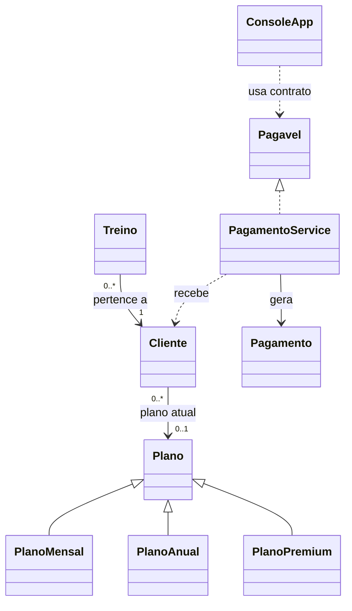

# Guia de estudo e apresentação — FitLife

**Aluno: Marcos Paulo Santos Mota**  
Anhanguera — Sistemas de Informação — Aula 15, Unidade 4.

## 1. O que cada classe faz

Todos os caminhos abaixo partem da pasta `FitLife/`.

| Arquivo em `src/main/java/fitlife/` | Função |
|---|---|
| `Main.java` | Abre o leitor do teclado, cria o console e inicia o menu. |
| `console/ConsoleApp.java` | Solicita dados, apresenta as opções 0 a 9 e mostra mensagens. Trata erros esperados para que o menu continue. |
| `model/Cliente.java` | Representa uma pessoa da academia: nome, e-mail, idade e plano atual. Valida a criação e as alterações permitidas. |
| `model/Plano.java` | Define o que todos os planos têm em comum: nome, valor base e obrigação de calcular a mensalidade. É abstrata. |
| `model/PlanoMensal.java` | Retorna o valor base como mensalidade. |
| `model/PlanoAnual.java` | Aplica 10% de desconto sobre a base mensal e calcula a soma de 12 mensalidades. |
| `model/PlanoPremium.java` | Guarda os benefícios descritos no cadastro e retorna seu preço mensal próprio. |
| `model/Treino.java` | Guarda ID, nome, descrição e a referência ao cliente responsável por aquele treino. |
| `model/Pagamento.java` | Representa o recibo de uma operação simulada. É um `record` imutável com os dados do momento do pagamento. |
| `interfaces/Pagavel.java` | Declara o método que um processador de pagamento precisa oferecer. |
| `service/ClienteService.java` | Mantém a lista de clientes, impede e-mails repetidos, consulta por e-mail e associa planos cadastrados. |
| `service/PlanoService.java` | Mantém os planos e permite consulta por ID, impedindo nomes duplicados. |
| `service/TreinoService.java` | Cadastra treino somente para cliente encontrado e permite listar todos ou os de uma pessoa. |
| `service/PagamentoService.java` | Implementa `Pagavel`, confere cliente/plano, calcula o valor, guarda o recibo e imprime a confirmação. |
| `exception/DadosInvalidosException.java` | Sinaliza quebra de uma regra de validação. Herda de `IllegalArgumentException`. |
| `exception/EntidadeNaoEncontradaException.java` | Informa que um cliente, plano ou treino solicitado não existe. |
| `util/Validacao.java` | Centraliza regras de texto obrigatório, idade, e-mail e dinheiro. |
| `util/Formatacao.java` | Apresenta valores na moeda brasileira. Não altera os cálculos. |

As quatro classes em `src/test/java/fitlife/` verificam clientes, planos, serviços e console. Cada teste monta um cenário, executa uma ação e compara o resultado com o esperado.

## 2. Relacionamentos

O plano existe independentemente de um cliente, e pode ser usado por várias pessoas: é uma associação, não herança. O treino guarda a referência ao objeto cliente já cadastrado. O recibo guarda cópias dos textos e do valor: trocar o plano depois não reescreve pagamentos antigos.

Um cliente pode começar sem plano. Ele pode ter vários treinos. O enunciado não condiciona o treino à existência de plano; por isso somente o pagamento exige plano associado. Não há dependência circular entre serviços: treinos usam clientes; clientes usam planos.

## 3. Onde a POO aparece

### Classes e objetos

Uma classe é a definição de um tipo; um objeto é uma instância concreta. `Cliente` define os campos e comportamentos. A expressão `new Cliente("Ana", "ana@exemplo.com", 18)` cria uma pessoa com aqueles dados.

### Encapsulamento

Os campos de `Cliente` são privados. O restante do sistema consulta `getNome()` e altera a idade com `setIdade(...)`. O setter valida o novo valor antes de guardá-lo; a aplicação não pode atribuir diretamente uma idade de 14 anos ao campo.

Não é obrigatório criar setter para todo atributo. O e-mail é imutável porque funciona como chave de busca. IDs, dados de treinos e planos também não precisam de alteração nesta atividade. `List.copyOf` impede que uma classe externa remova itens da lista interna do serviço. É uma proteção estrutural: os objetos `Cliente` continuam oferecendo seus métodos de alteração válidos.

### Herança

`PlanoAnual extends Plano` expressa que um plano anual **é um** plano. Ele reaproveita nome e valor base, validando-os pelo construtor da superclasse com `super(...)`. A mesma relação existe para Mensal e Premium.

### Abstração

Não se cria `new Plano(...)`, pois a classe é abstrata. Ela descreve a ideia geral de plano, mas deixa o cálculo concreto para as subclasses. Um método abstrato declara a operação sem implementar seu corpo.

### Polimorfismo

No pagamento, `cliente.getPlano()` retorna uma referência do tipo `Plano`. Ao chamar `calcularMensalidade()`, Java executa a implementação do objeto concreto. Para base de R$ 100,00, o objeto Mensal retorna R$ 100,00 e o Anual retorna R$ 90,00. O serviço de pagamento não precisa de `if` para cada modalidade.

O `switch` de cadastro escolhe qual objeto criar com base na entrada do usuário. Depois da criação, a operação comum de calcular usa polimorfismo. O `instanceof` do console apenas apresenta o total anual adicional.

### Interface

`Pagavel` é um contrato: recebe um `Cliente` e devolve um `Pagamento` por meio de `processarPagamento`. `PagamentoService` cumpre esse contrato. O campo do console é do tipo `Pagavel`, demonstrando que o console pode chamar o contrato sem depender do nome da implementação na utilização do método.

A interface não fornece armazenamento ou a simulação. Esses detalhes ficam na classe concreta. O ponto de montagem do console ainda cria um `PagamentoService`, o que é suficiente para um projeto pequeno.

### Exceções

Uma exceção interrompe a operação que não pode continuar. `DadosInvalidosException` informa uma violação das regras, e `EntidadeNaoEncontradaException` uma busca sem resultado. O console captura esses erros esperados e apresenta a mensagem.

Como a exceção de dados herda de `IllegalArgumentException`, o mesmo `catch` também trata números malformados convertidos em erro de argumento. Não se usa `catch (Exception)` para esconder qualquer defeito de programação.

## 4. Métodos principais, em linguagem simples

| Método | Passos |
|---|---|
| `Cliente(...)` | Valida os três dados antes de disponibilizar o cliente. |
| `setIdade(...)` | Confere se o novo valor é pelo menos 15; se não for, preserva o valor anterior. |
| `ClienteService.cadastrar(...)` | Cria um cliente válido, verifica repetição do e-mail e só então adiciona à lista. |
| `buscarPorEmail(...)` | Normaliza o texto e procura o cliente. Se não achar, lança a exceção de busca. |
| `associarPlano(email, id)` | Encontra o cliente, encontra o plano e entrega a referência ao método do cliente. |
| `PlanoAnual.calcularMensalidade()` | Multiplica a base mensal por `0.90` e arredonda o resultado para centavos. |
| `calcularTotalAnual()` | Multiplica a mensalidade calculada por 12. Não realiza cobrança de uma só vez. |
| `TreinoService.cadastrar(...)` | Busca o cliente existente, valida os dados do treino, atribui ID e guarda na lista. |
| `processarPagamento(...)` | Rejeita cliente nulo e cliente sem plano, pede ao plano seu valor, registra o recibo e imprime a confirmação. |
| `ConsoleApp.executar()` | Repete o menu, encaminha a escolha para a operação e trata os erros esperados até sair. |
| `lerInteiro(...)` | Lê uma linha inteira e tenta transformá-la em número inteiro. |
| `lerDinheiro(...)` | Aceita ponto ou vírgula decimal, rejeita formatos ambíguos e cria um `BigDecimal`. |

O `Scanner` lê sempre linhas com `nextLine()`. Isso evita o problema comum de misturar `nextInt()` com `nextLine()` e deixar uma quebra de linha pendente.

## 5. Funcionamento do início ao fim

1. `Main` prepara o leitor de entrada em UTF-8.
2. `ConsoleApp` monta os serviços com listas vazias e uma saída para o console.
3. O menu solicita uma opção. Ao cadastrar, cada serviço chama os construtores e as regras de validação.
4. Os objetos válidos são armazenados em `ArrayList`. Um cadastro inválido não é inserido.
5. Depois de criar cliente e plano, a opção 5 conecta os dois objetos.
6. A opção 6 conecta um novo treino ao cliente já encontrado.
7. A opção 8 busca o cliente e chama o contrato `Pagavel`.
8. O serviço chama o método do plano concreto, registra o recibo e exibe sucesso simulado.
9. A opção 9 mostra o cliente, seu plano e seus treinos.
10. A opção 0 encerra o laço. `Main` fecha o leitor. Os dados da sessão são perdidos.

## 6. Demonstração prática para o professor

Use um terminal em UTF-8. O e-mail `marcos@exemplo.com` e a idade `20` são dados fictícios de demonstração; não foram inferidos como dados pessoais do aluno.

| Ação | Entrada | Resultado a observar |
|---|---|---|
| Validar a idade | Cadastre Ana, `ana@exemplo.com`, idade `14` | Mensagem de idade mínima; sem cadastro |
| Validar menu | Digite `abc` e depois `10` | Mensagens de erro; menu continua |
| Criar cliente válido | Nome do aluno, e-mail demonstrativo, idade `20` | Cliente cadastrado sem plano |
| Tentar pagar antes da associação | Opção 8 e o e-mail | Erro de cliente sem plano |
| Criar Mensal | Tipo 1, nome Mensal, base `100,00` | Mensalidade R$ 100,00 |
| Criar Anual | Tipo 2, nome Anual, base `100,00` | Mensalidade R$ 90,00; total R$ 1.080,00 |
| Criar Premium | Tipo 3, nome Premium, base `150,00`, benefícios | Mensalidade R$ 150,00 e descrição |
| Associar Anual | Opção 5, e-mail, ID consultado na opção 4 | Associação concluída |
| Cadastrar treino | Opção 6, e-mail, Treino A, descrição demonstrativa | Treino #1 com cliente correto |
| Consultar | Opções 2, 4, 7 e 9 | Dados consistentes |
| Pagar | Opção 8 e o e-mail | Recibo SIMULADO de R$ 90,00 |
| Encerrar | Opção 0 | Encerramento controlado |

Rode `mvn test` e mostre o total dos testes. Explique que sucesso nos testes confirma os cenários verificados, sem provar ausência de todos os defeitos possíveis. Os exemplos de treino são dados para testar software, não uma prescrição de atividade física.

## 7. Fala resumida para apresentar

> Meu nome é Marcos Paulo Santos Mota e este é o sistema FitLife, desenvolvido em Java 17 para a atividade de implementação e validação. O sistema cadastra clientes, planos e treinos, associa um plano ao cliente e simula o pagamento da mensalidade. Separei as classes de domínio, os serviços e o console para organizar as responsabilidades.
>
> A classe Cliente demonstra encapsulamento com atributos privados e validações. Plano é abstrata e serve de base para Mensal, Anual e Premium. No pagamento, o cálculo é polimórfico: o serviço chama calcularMensalidade e cada plano aplica sua regra. O Anual oferece 10% de desconto sobre a base mensal. A interface Pagavel define o contrato implementado pelo serviço de pagamento.
>
> Os dados ficam em listas na memória. Entradas inválidas geram exceções tratadas pelo menu, permitindo continuar usando o programa. A validação executou 62 casos JUnit 5, cobrindo regras e integração. Os pagamentos são simulados e não movimentam dinheiro. Como melhorias futuras, eu acrescentaria persistência e controle da competência dos pagamentos.

## 8. Perguntas possíveis e respostas

**1. Por que Plano é abstrata?**  
Porque representa uma ideia comum que exige um cálculo concreto. Evita instanciar um plano genérico sem regra de mensalidade.

**2. Qual a diferença entre herança e associação aqui?**  
Anual é um Plano: herança. Cliente tem um Plano: associação. Treino pertence a um Cliente: outra associação.

**3. Onde está o polimorfismo?**  
Em `cliente.getPlano().calcularMensalidade()`. O método executado depende do tipo real do plano, mesmo que a referência seja `Plano`.

**4. Para que usar uma interface se há uma implementação só?**  
Para definir e demonstrar o contrato. Ela permite que o consumidor trabalhe com `Pagavel` e que outra implementação seja acrescentada posteriormente.

**5. Por que não usar double para dinheiro?**  
`double` usa representação binária aproximada. `BigDecimal`, criado a partir de texto decimal, permite trabalhar com centavos e arredondamento explícito.

**6. Qual o valor base do Anual: mensal ou anual?**  
Mensal. Com base 100, aplica-se 100 × 0,90 = 90 por mês. O total em 12 meses é 1.080. A simulação cobra uma mensalidade por operação.

**7. Como o arredondamento afeta o total anual?**  
Base 99,95 gera 89,955, arredondado para 89,96. O total é 89,96 × 12 = 1.079,52, coerente com as parcelas.

**8. Por que não há setter de e-mail?**  
O e-mail identifica o cadastro. Mudá-lo diretamente poderia burlar a regra de unicidade e afetar as buscas. Só foram expostas as alterações necessárias.

**9. Como o sistema impede treino de cliente inexistente?**  
O serviço busca o e-mail no cadastro antes de construir e adicionar o treino. A falha de busca impede a inserção. O modelo sozinho valida a referência, e o serviço valida a existência no cadastro.

**10. O que acontece se o usuário digitar uma letra na idade?**  
A conversão falha e é transformada em um erro de argumento com mensagem amigável. O menu captura o erro, cancela a operação e reaparece.

**11. IllegalArgumentException e a exceção personalizada são diferentes?**  
`DadosInvalidosException` é uma especialização de `IllegalArgumentException`. Assim ela dá um nome às regras do domínio e continua compatível com o tratamento de argumento inválido.

**12. Os dados permanecem ao fechar o programa?**  
Não. As listas existem apenas na memória. Isso atende ao escopo, que não exige banco de dados.

**13. O pagamento é real?**  
Não. Há cálculo, registro em memória e impressão do recibo. Não existe integração financeira.

**14. É possível pagar duas vezes?**  
Sim, cada operação gera uma simulação independente. Não foi implementado controle por competência. Essa limitação está documentada.

**15. Por que o recibo é um record?**  
É um recurso do Java 17 adequado a dados imutáveis. Ele fornece acesso aos componentes, igualdade e hash; usamos um construtor compacto para validar e um `toString` para o recibo. Os acessores são `valor()`, `id()` e semelhantes.

**16. List.copyOf deixa todos os dados imutáveis?**  
Não. Impede adicionar/remover itens pela lista devolvida. Um objeto Cliente continua mutável pelos setters validados. É uma cópia superficial e uma proteção da coleção.

**17. Por que o cadastro está nos serviços, não em Treino?**  
Treino representa os dados de um treino. O serviço conhece a lista e os demais cadastros, então decide como registrar e consultar. Isso evita misturar entidade com gerenciamento de armazenamento.

**18. Os testes foram executados?**  
Sim. A validação local executou 62 casos com zero falhas e gerou o JAR. Os comandos e a divisão estão em `docs/VALIDACAO.md`. Um novo ambiente deve repetir `mvn clean verify`.

**19. Como acrescentar outro tipo de plano?**  
Crie uma subclasse de Plano, implemente calcularMensalidade e ofereça a opção de criação no menu. O cálculo no pagamento continua chamando o mesmo contrato.

**20. O que você melhoraria?**  
Persistência em arquivo ou banco; identificação independente do e-mail; competência e vencimento; edição controlada; testes para novas regras. Essas melhorias não estão implementadas nesta entrega.

## 9. Preparação final

Antes da apresentação, execute o sistema na máquina em que será demonstrado, confira o Java, repita os testes e pratique o roteiro. Revise os métodos citados para explicar com suas próprias palavras. O repositório desta entrega está público e pode ser consultado pelo professor sem convite. O print incluído em `docs/imagens/fitlife-execucao.png` mostra a saída real do Java em uma janela de demonstração com entradas automatizadas.
